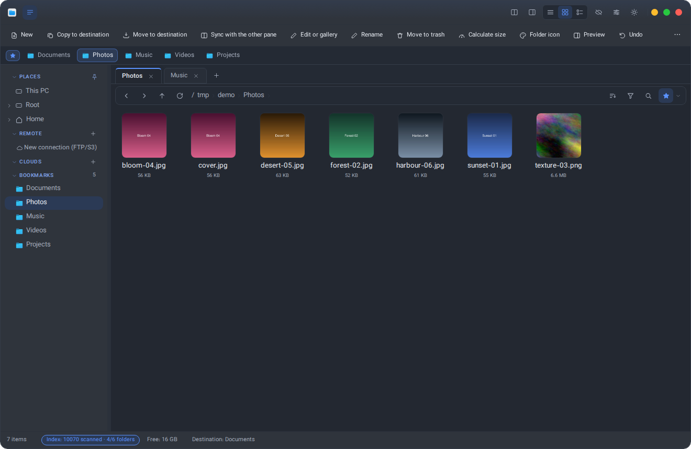
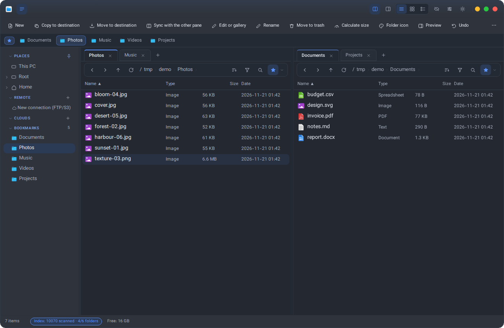
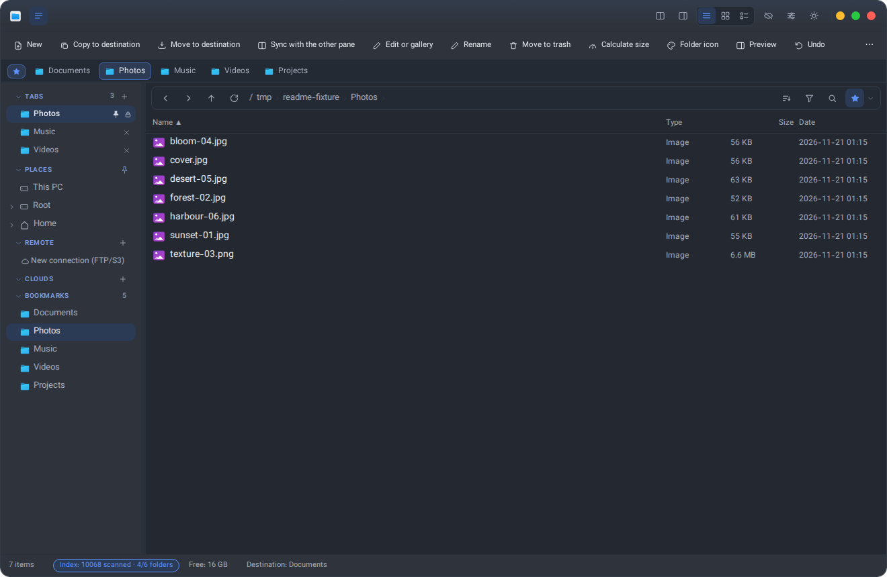
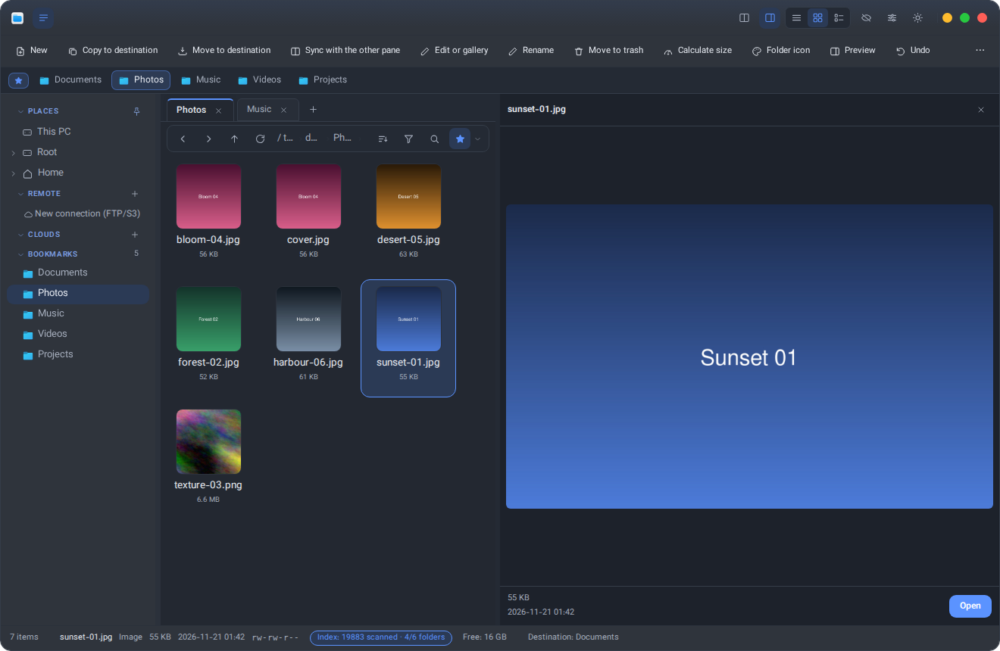
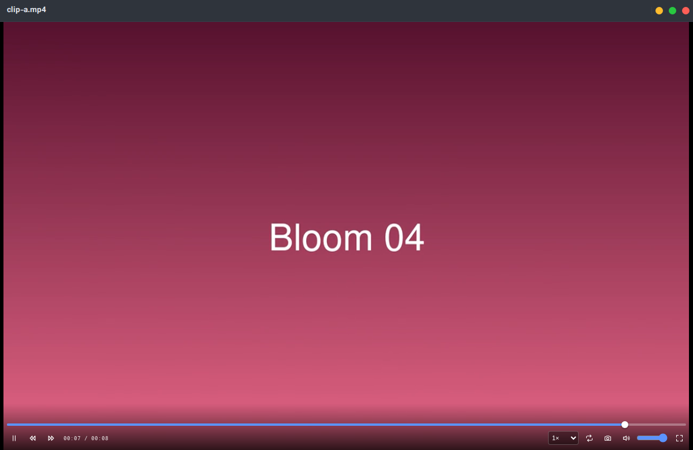
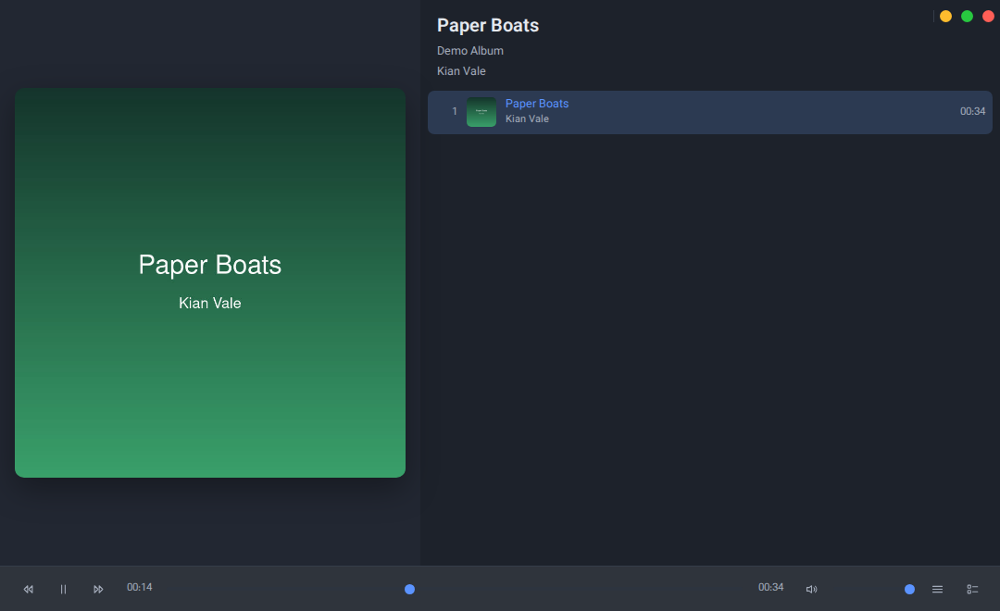
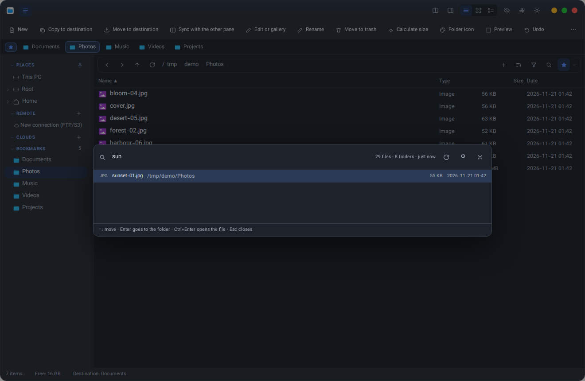
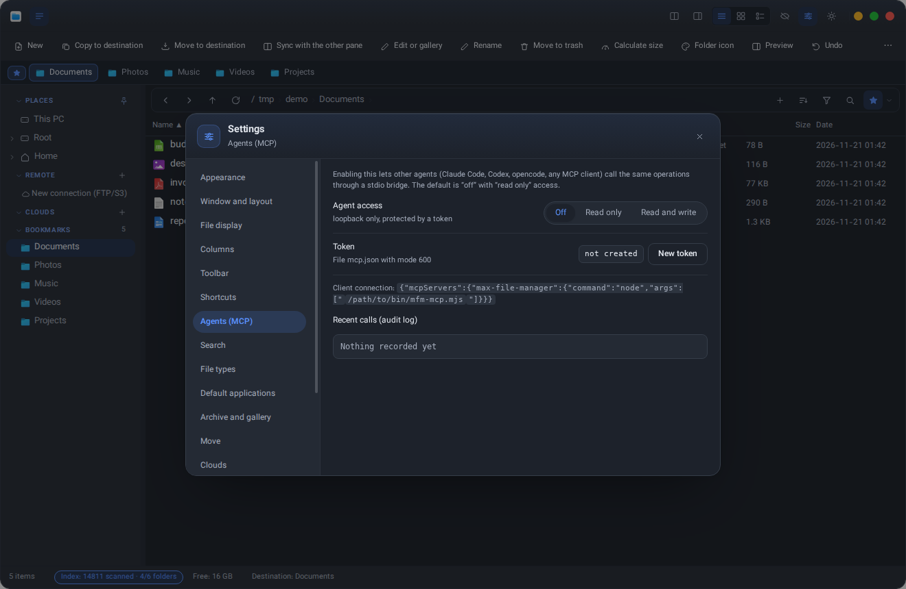
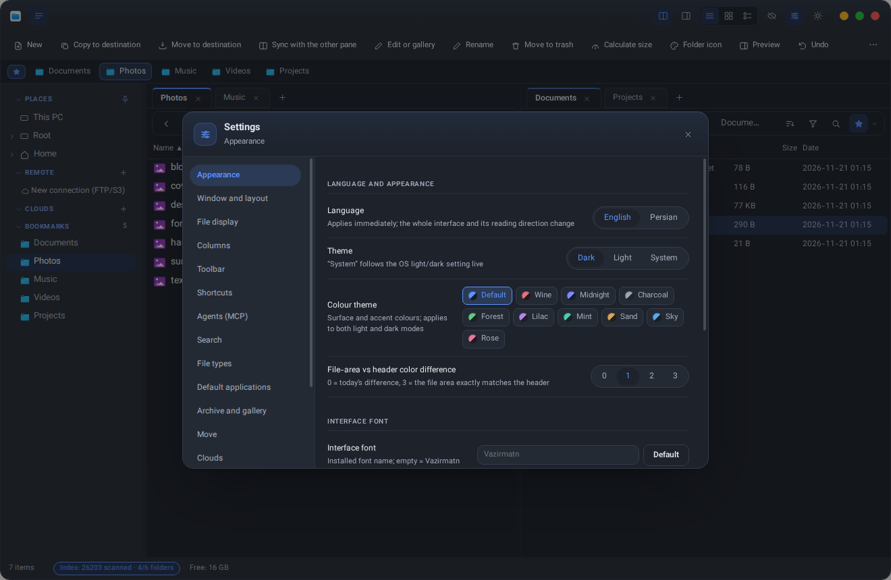

# Max File Manager

A two-pane desktop file manager for Linux (KDE first) and Windows: real tabs, a transfer queue, cloud folders, remote servers, an indexed search, previews and players that do not need another app, and a loopback agent API over the same operations the UI uses. Built with Electron, TypeScript and React. **English by default**, Persian (RTL) one click away, and every path and file name keeps its own direction. The complete **Pure** icon set (3,000+ SVGs) ships inside the app, so files look the same on every machine.



## At a glance

| | |
|---|---|
| **Two panes, real tabs** | pinned tabs, drag to reorder, rename, lock (a locked tab opens a new one instead of navigating), per-tab colour, folder icon, tab menu, `Ctrl+T`/`Ctrl+W`, per-pane back/forward history |
| **Layout is yours** | tabs on top or at the bottom, tabs as a vertical column in the sidebar, sidebar left or right, single or dual pane, four levels of file-area tint — every default is what the app did before the option existed |
| **Nothing is overwritten** | an existing name becomes `name (2).ext`; delete goes to the OS trash unless you hold `Shift` |
| **Transfers never block the UI** | a queue with byte progress, speed, pause/resume, cancel, per-item errors and one undo step |
| **Local, remote and cloud in one place** | FTP/FTPS/SFTP/S3 tabs, and Google Drive, Dropbox, OneDrive and WebDAV folders kept in step by a three-way comparison ([docs/CLOUD.md](docs/CLOUD.md), [docs/REMOTE.md](docs/REMOTE.md)) |
| **One command registry** | every action is a command (`commands.ts`); the toolbar, the shortcut editor and the status bar read the same list, and every key is rebindable |
| **Agents, off by default** | a bearer-token loopback API exposing 126 tools over the *same* main-process functions the UI calls ([docs/MCP.md](docs/MCP.md)) |
| **The file view never runs web content** | `contextIsolation`, no `fs` and no `file://` in the renderer; images and PDFs travel over `mfm://`, which serves absolute paths only |

## Panes, tabs and views

Three views share one keyboard and selection model: **details** with sortable columns, **grid** with real 256 px thumbnails, and **compact** (Dolphin's icon list). `Ctrl+Shift+V` cycles them; each folder keeps its own view, sort and grouping in a hidden `.mfm.json`, so a folder opens next month the way you left it.



- Columns: type, size, date (ISO or Jalali), permissions, owner, hard links, image dimensions — show, hide and resize them; a small multi-line caption under each name is configurable per field.
- Colour labels (8 colours), star ratings, per-file notes, pinned files and a coloured dot in front of the name; labels drive `#label` filters and the sidebar counts.
- Per-folder colour and icon (Pure's coloured folder variants, the OS theme, or line glyphs) written into the folder itself, so other file managers see it too.
- Virtualized rendering: a 100k-entry folder mounts only the visible slice.
- Rubber-band selection, type-to-filter, an inline address bar (`Ctrl+L`), and a properties sheet with permissions (real `chmod`), checksums and tags.
- Vertical tabs put the strip in the sidebar above Places, so a single-pane window gives the whole width to the files:



## Previews, editor and players

`F3` opens the preview beside the list (or in the opposite pane): images, audio, video, PDF through Chromium's own viewer, HTML in a sandboxed frame with scripts stripped, and text with syntax colouring and per-line direction — Persian lines right-aligned, code always LTR. A file type the app cannot render shows its own icon and opens in its application; there is no stand-in preview.



`F4` is the editor: a visual Markdown surface (Milkdown/Crepe — slash menu, tables, task lists, CodeMirror blocks) or the highlighted source view, atomic `Ctrl+S`, and a one-button PDF export with embedded Vazirmatn. Opening a second text file saves the first one if it changed.

Both players are windows of their own, so they survive switching folders:

- **Video** (`Ctrl+Shift+M`): the folder's video list on the side, subtitles (external SRT/VTT and embedded), chapters, speed, loop, frame capture, byte-range seeking — and **real fullscreen**: the window goes fullscreen through the window manager, with a fallback to the display's own rectangle when the WM refuses. The player's chrome (head row, caption buttons, transport bar) hides itself and returns on a move or a click; `Esc` leaves fullscreen without closing the window.

  

- **Music**: cover art, tags, playlist, seek, volume. The sound lives in the main window, so closing the player stops playback instead of leaving a hidden stream running. An `.m3u`/`.m3u8` opens straight into the playlist.

  

MKV/AVI and other containers Chromium cannot demux are prepared by system FFmpeg **without re-encoding**: the streams are copied into an MP4 and cached in `~/.config/max-file-manager/video-cache`, so each file is prepared once and opens instantly afterwards. The gallery (`Space`) browses a folder's images with zoom, rotate, crop, resize, a filmstrip and a slideshow.

## Finding things

An SQLite FTS5 index over the folders you choose (with exclusions) answers instantly and jumps to the containing folder with the file selected — keyboard first, Persian queries included. `Ctrl+K` opens it from anywhere.



`Ctrl+Shift+Y` compares two folders by modification time, creation time or content hash, with ignore patterns, a differences-only view and trash-safe deletes; `Ctrl+Shift+Z` diffs two selected files; duplicate detection groups files by content hash and reports the reclaimable bytes instead of deleting anything.

## Cloud folders and remote servers

A Drive, Dropbox, OneDrive or WebDAV folder becomes a tab that stays in step with the provider: a three-way baseline (local, remote, last common state) decides per path whether to upload, download, conflict or skip, so a run never re-uploads a tree another client already filled. Conflicts are listed per path and clickable. OAuth tokens and passwords live in the OS keyring (`safeStorage`), never in a config file.

FTP, FTPS (explicit and implicit), SFTP (password, private key or SSH agent, `~/.ssh/config` import, `known_hosts` verification) and S3-compatible buckets (AWS, MinIO, Ceph) open as tabs and work as transfer endpoints in both directions; preview, editor and gallery read through a local cache.

## Archives, images, tags

The archive engine is opt-in (Settings → Archive) and auto-browsing ZIPs is capped by a size you choose; when enabled, zip and tar/tar.gz/tar.zst open as listings, `F5` extracts into the other pane, and archives are created and extracted by an in-app engine: streamed ZIP with ZIP64, levels 0–9, AES-128/192/256 or legacy ZipCrypto passwords, comments, timestamps, permissions and symlinks; tar with PAX long names plus gzip/zstd. Listing never reads entry data and extraction never buffers the archive, so large files stay cheap. Extraction honours a four-way conflict policy, verifies CRC/HMAC, and refuses zip-slip paths ([docs/ARCHIVES.md](docs/ARCHIVES.md)). Batch image conversion (JPEG/PNG, longest side, quality) and listing export to CSV (UTF-8 BOM) or PDF. ID3v2 tags are read *and written* in place — merging, never rewriting frames nobody asked to change — so titles, artists, covers and track numbers can be fixed in bulk; EXIF stays read-only.

## The system file chooser (Linux)

The app can answer `org.freedesktop.impl.portal.FileChooser`, so a browser's or Electron's "open/save file" dialog becomes this window, with the same views — including the per-folder view, sort and grouping memory of the main window.

## Agents (MCP), off by default

A loopback HTTP API with a bearer token (`~/.config/max-file-manager/mcp.json`, mode `600`) exposes 126 tools over the same operations the UI uses — files, transfers, the index, tags, colours, ratings, cloud folders, players and the window itself — plus a dependency-free stdio bridge (`bin/mfm-mcp.mjs`) and an append-only audit log that records the tool and the *shape* of its arguments, never file contents. Modes: `off` (default), `read`, `write`.



## Settings

One typed preferences object in SQLite, persisted atomically with the window and session state: appearance, file display, columns, toolbar, shortcuts (with conflict detection), window and layout, transfers, file operations, startup, file types, default applications, archive and gallery, music and video, search, agents, advanced. Ten colour palettes on top of light/dark, a live English/Persian switch, and a rebindable key for every command.



The roadmap the pages were derived from: [docs/PREFERENCES.md](docs/PREFERENCES.md).

## Keyboard (defaults, all rebindable)

- `F5` copy · `F6` move · `F7` new folder · `Ctrl+N` new file from a template · `F2` rename (batch when several are selected)
- `F8` trash · `Shift+Delete` delete permanently · `F9` folder size · `F3` preview · `F4` editor/gallery/player · `Ctrl+Z` undo
- `Alt+←`/`Alt+→` back and forward · `Backspace` up · `Tab` switch pane · `Ctrl+L` inline address bar · type to filter
- `Ctrl+K` search · `Ctrl+Shift+Y` folder sync · `Ctrl+Shift+F` flat view · `Ctrl+H` hidden files · `Ctrl+D` bookmark · `Ctrl+M` music · `Ctrl+Shift+M` video window
- `Space` gallery · `Esc` clear selection and close overlays

## Run it

```sh
npm install
npm run dev        # dev window with hot reload
npm test           # 541 unit tests: transfers, undo, search, archives, previews, hashes,
                   # folder meta, icon packs, keys, prefs, sorting, templates, cloud compare
npm run typecheck
npm run build && npm start
```

Packaging:

```sh
npm run dist:linux   # AppImage + deb
npm run dist:win     # NSIS installer (build on Windows, or via wine on Linux)
```

A headless render check needs no desktop — `SMOKE_JS` drives the real UI before the shot:

```sh
SMOKE_SHOT=/tmp/mfm.png xvfb-run -a npx electron .
SMOKE_JS="[...document.querySelectorAll('.tb')][0].click()" SMOKE_SHOT=/tmp/mfm.png xvfb-run -a npx electron .
```

## Why Electron

Listing, stat, transfers, hashing, archive reading and the SQLite index are native `fs`/`crypto` work in the main process; the renderer only paints. That buys one codebase for KDE and Windows, and a UI that can be rebuilt cheaply as the feature set grows (two panes, tabs, virtual lists, toolbars, dialogs). It costs a ~150 MB memory baseline against a native toolkit, and OS integration (context menus, thumbnails, tray, fullscreen) has to be written by hand instead of coming from the desktop environment.

## Layout

```
src/main/index.ts        window and chrome, filesystem IPC, folder sizes, session state, mfm:// and thumb://
src/main/jobs.ts         transfer queue: progress, pause, cancel, undo, batch rename, mkdir
src/main/search.ts       recursive walk, name matcher, content search, duplicate finder
src/main/searchdb.ts     SQLite FTS5 index of the chosen folders
src/main/zip-archive.ts  ZIP listing/ZIP64, streaming extraction, AES/ZipCrypto, creation
src/main/tar-archive.ts  tar (ustar/pax/GNU) with gzip and zstd
src/main/archives.ts     archive surface: format detection, sources, conflict policy, progress
src/main/meta.ts         per-folder colour/icon/labels/notes/pins in the folder's own .mfm.json
src/main/cloud-*.ts      Drive / Dropbox / OneDrive / WebDAV clients, the sync engine and its store
src/main/remotes.ts      FTP, SFTP and S3 profiles with keyring-backed secrets
src/main/player.ts       video jobs, FFmpeg cache, subtitles, frame capture
src/main/player-core.ts  playback/remux/transcode decisions, Range and SRT→VTT (pure, tested)
src/main/mcp.ts          loopback agent API over the same operations, token, audit log
src/main/portal.ts       xdg-desktop-portal FileChooser backend (Linux file dialogs)
src/preload/index.ts     the only bridge into the renderer
src/renderer/src/        React UI: App, Pane, TabStrip, Sidebar, PortalPicker, Preferences,
                         VideoPlayer, StandaloneVideo, StandaloneMusic, Editor, Gallery,
                         PreviewPanel, i18n.ts, prefs.ts, format.ts, themes.ts, pure-set.ts
bin/mfm-mcp.mjs          dependency-free stdio MCP bridge
docs/                    FEATURES.md (Opus matrix), PREFERENCES.md, MCP.md, CLOUD.md,
                         REMOTE.md, INTEGRATION.md, SYNC.md, RELEASE.md
AGENTS.md                rules for agents working in this repo
```

## License

MIT
